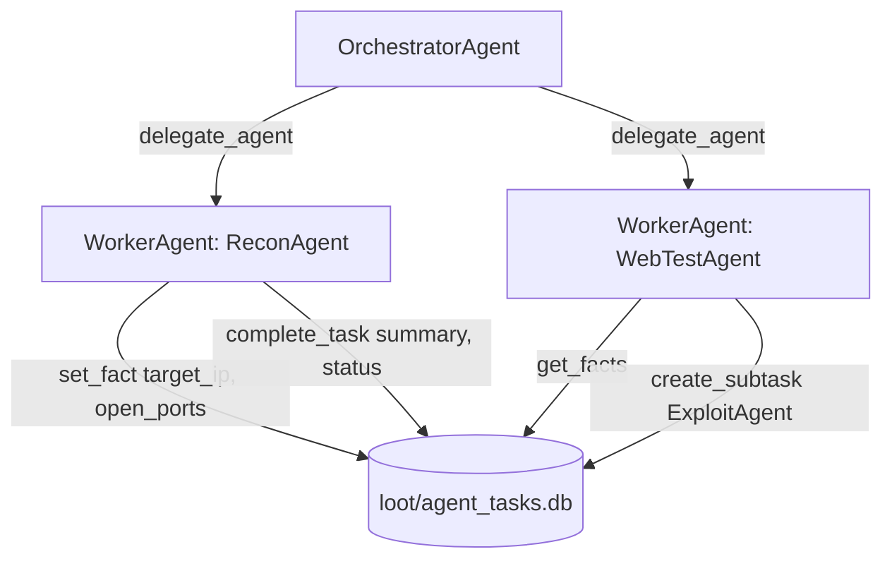

# Local Model Runner — Design Notes & Roadmap

Working notes for `runner/`: a standalone Ollama/litellm agent loop that drives
the same `agents/*/definition.md` personas as the Copilot Chat / `gh copilot`
workflow, for when a local model is preferred (no Copilot subscription,
air-gapped engagement, cost, or just wanting to run local models).

Status: **Phase 1 shipped and verified** (offline fake-LLM test + live test
against a real Ollama server running `gemma4:12b`). Phase 2 (decoupled
scheduler) is proposed but not started — see below.

---

## Why this exists

`gh copilot` / Copilot Chat only work against GitHub Copilot's backend. There
was no way to drive the `agents/` persona stack against a local model. `runner/`
reimplements the minimum needed: an LLM client, a tool-calling loop, and a way
for agents to hand off work to other agents — modeled on the multi-provider
`llm.py` pattern from `Agentic-Pentesting-Orchestrator`, trimmed to Ollama-only.

## Problems hit during testing (all real, all fixed)

1. **litellm import crash: `pycares` has no attribute `ares_query_a_result`.**
   Root cause: `NetExec`'s `aardwolf` dependency, installed ~90 Dockerfile lines
   after litellm, silently downgrades `pycares`/`aiodns` because every
   `RUN pip install` in the Dockerfile resolves independently — a later step can
   clobber an earlier version pin. Fixed by re-pinning `pycares>=4.6 aiodns>=3.2`
   as the **last** pip step before `COPY agents/`, so nothing after it can touch
   it again.
2. **Zero visibility into what the model was doing.** The loop only printed
   `tool_name(args)`, never the model's reasoning text or the tool's output, so
   a run that silently failed (see #3) looked like a black box. Fixed by
   printing the model's own text each turn, a truncated preview of every tool
   result, and writing the full untruncated transcript to
   `loot/agent_logs/<timestamp>-<agent>-d<depth>-<id>.jsonl` (JSON lines, one
   message per line) for post-hoc inspection.
3. **Small models sometimes go blank instead of finishing.** A `gemma4:12b` run
   stopped mid-engagement with an empty message and no tool calls — the loop's
   only "done" signal was "model stopped calling tools," which isn't reliable.
   This is the core motivation for the DB-backed task system below.
4. **Context exhaustion silently corrupts behavior, not just truncates.** Ollama
   drops tokens from the **front** of the sequence once `num_ctx` is exceeded,
   which can silently discard the system prompt/persona rather than failing
   loudly. Mitigated with rolling compaction (collapse old tool turns into
   one-liners once history crosses ~60% of `num_ctx`) and `LLM_SLIM_PROMPT=1`
   (drop the full CLI tool inventory from the system prompt).

## Phase 1 — DB-backed tasks & facts (shipped)

SQLite store at `loot/agent_tasks.db` (`runner/db.py`):

| Table | Purpose |
|-------|---------|
| `tasks` | `id, parent_id, agent, title, description, status, result, created_at, updated_at`. `status` ∈ `pending/in_progress/completed/blocked/failed`. |
| `facts` | `key, value, set_by, updated_at` — shared engagement facts (target IP, open ports, creds found) so agents don't re-derive or re-state context. |
| `events` | `id, task_id, agent, message, created_at` — append-only activity log. |

New tools (`runner/tools.py`, wired via `build_db_tools()`):

- `get_facts(keys?)` / `set_fact(key, value)` — shared state instead of giant kickoff prompts.
- `create_subtask(agent, title, description)` — queue work for another agent (currently still executed inline via `delegate_agent`; true async dispatch is Phase 2).
- **`complete_task(summary, status)`** — the fix for problem #3. Explicit, unambiguous termination signal. `agent_runner.py` special-cases this tool name and ends the loop deterministically the moment it's called, instead of waiting for the model to go quiet.

`AgentRunner` (`runner/agent_runner.py`) changes:
- Accepts optional `db: TaskDB` / `task_id: int`.
- `delegate_agent` now creates a tracked child task row per hand-off.
- All three loop-exit paths (`complete_task`, empty final message, max-iterations exhausted) record a task status/result to the DB, so nothing is left silently dangling as `pending`.
- System prompt (`agent_loader.py`) conditionally explains the DB tools and makes `complete_task` a hard requirement when a DB is attached.

`main.py` creates/opens the DB automatically and seeds a root task for the
top-level invocation; `--no-db` disables all of this for a plain conversational
run.

**Verified:**
- Offline: scripted fake `litellm.completion` responses through `get_facts` → `set_fact` → `complete_task`; confirmed task row updates to `completed` and fact persists.
- Live: same flow against the user's real Ollama server (`gemma4:12b`, 3 iterations, correct DB writes) — no blank-report failure.

## Phase 2 — proposed, not started

The bigger structural change, gated on Phase 1 holding up against real HTB
targets:

1. **Decouple `create_subtask` from execution.** Right now it's still a
   synchronous `delegate_agent` call under the hood — the calling agent blocks
   until the sub-agent finishes. True decoupling means `create_subtask` only
   enqueues a `pending` row, and a separate dispatch loop (`scheduler.py`)
   picks up pending tasks and runs them, independent of who created them.
   This is what actually bounds Orchestrator's own context to
   "number of tasks," not "total sub-agent tool-call volume."
2. **Move deterministic phase-gating out of the LLM.** The
   `VPN → Recon → Exploit → Foothold → PrivEsc → Flags` gating described in
   `agents/OrchestratorAgent/definition.md` (e.g. "PrivEscAgent only runs after
   `loot/foothold.yaml` exists") doesn't need an LLM decision at all. A plain
   Python state machine can enforce these gates directly against the DB/loot
   files; the LLM is only needed for the *triage* decision ("given this recon
   signal, which specialist(s) should get a task?"), which is a small, focused
   call rather than a 60-iteration Orchestrator loop.
3. **Worker context stays task-scoped.** Each dispatched task gets a fresh
   `AgentRunner` with only: the task description, relevant `get_facts` results,
   and a bounded `max_iterations`. No task ever sees another task's full
   transcript — only its one-line DB summary.

Open questions before starting Phase 2:
- Single-process polling loop (simplest, matches current container model) vs.
  anything fancier — no need for real concurrency here, one engagement at a
  time.
- How much of `OrchestratorAgent/definition.md`'s phase logic to hard-code in
  Python vs. leave as LLM-driven triage prompts — worth revisiting once Phase 1
  has run against a real machine.

## Reference

- Code: [`runner/`](../runner/) — `main.py`, `agent_runner.py`, `agent_loader.py`, `llm.py`, `tools.py`, `db.py`.
- Usage docs: see the "Local Models (Ollama via litellm)" section in [`README.md`](../README.md).
- Original inspiration: `Agentic-Pentesting-Orchestrator/runner/agent_runner/llm.py` (multi-provider litellm client this was trimmed down from, Ollama-only).
